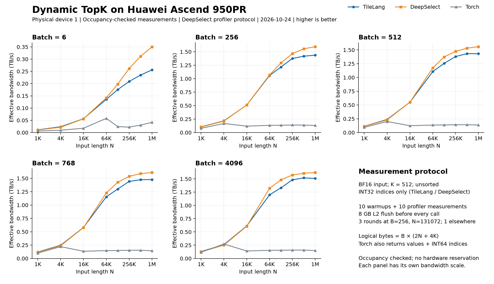

# Huawei Ascend TopK

A BF16 TopK macro written entirely in TileLang SIMD, following DeepSelect
`bfa4507d935f17ebfc3d0f00ff7d3c9a4d0e5c18`: histogram radix selection,
triple-buffered transfers, and optional ascending index radix sort. No external
kernel is called. `deepselect.LICENSE` retains the adapted implementation's MIT notice.

## Usage

```python
import torch
from example_topk import topk

values, indices = topk(x, 512, indices_type=torch.int32)
_, indices = topk(x, 513, indices_type=torch.int32, return_value=False)
```

The wrapper follows DeepSelect's Python argument order and returns `(values,
indices)` with logical shape `[B,K]`; values are `None` when disabled. Pass
`indices_type=torch.int32`: DeepSelect's shared default is INT64, which this
backend rejects. `output_idx` accepts a preallocated aligned output tensor.

Only the capacity tier (512/1024/4096), `sorted_index`, and
`abort_when_nan_found` select a compiled kernel. Batch size, N, exact K, all row
strides, `return_value`, optional end/offset presence, and fill values are runtime
parameters. Changes within a tier reuse the same compiled kernel. Tensor contents
are never cache keys. JIT compilation occurs on the first call to each variant.

`make_topk_macro(capacity, sorted_index=..., abort_when_nan_found=...)` returns
`select(X, I, V, end, offsets, row, n, k, return_value, has_end, has_offset,
index_fill, value_fill_bits)`. See the example for dynamic buffer declarations.

- Huawei Ascend 950; BF16 input, INT32 indices; `1 <= K <= capacity`, `0 <= N < 2**21`.
- Unit inner strides and non-overlapping, 32-byte-aligned row strides.
- `begin`, `hint`, and sorting by value are unsupported, matching the original backend.
- Callers must ensure `0 <= end[i] <= N`. Short rows pad outputs; offsets do not
  apply to padding. Equal scores may select different indices from Torch.
- NaN checking is always enabled. Disabling abort fills affected index rows with
  `0x3f3f3f3f`; values are undefined. Enabling abort issues a device assertion.
- The macro owns 248 KiB UB and events 0..3. Call once per block with
  `tl.enable_auto_schedule=False` and `tl.disable_thread_storage_sync=True`.
  Direct macro callers must validate buffer layouts and runtime parameter ranges.

## Validation

```bash
pytest -q test_topk.py
python example_topk.py --k 512
python example_topk.py --k 4096 --sorted-index
```

Tests cover K tiers, dynamic lengths/strides, offsets, padding, NaN, index sorting,
value/index correspondence, preallocated output, and reuse of one compiled
kernel while changing runtime parameters. No DeepSelect library is required.

The final dynamic implementation with INT64 row strides passed 63 tests on
Huawei Ascend 950PR_9579 with CANN `9.3.0~weekly.20261009.01`. All six
non-abort capacity/index-order variants compiled. Tests also cover enabled abort
with non-NaN input. Generated CCE keeps N, K, flags, fills and INT64 strides as
runtime arguments. Device disassembly confirms histogram, compaction and
radix-sort gather/scatter instructions. This checks instruction presence, not
instruction-by-instruction equivalence or performance parity with DeepSelect.

## Performance

Measured on Huawei Ascend 950PR_9579 on 2026-10-24. No foreign device-1 process
was observed at the checks for accepted measurements: before/after each
measurement and every two seconds during profiling. Measurements with observed
interference were discarded and retried when idle. This is sampled occupancy
monitoring, not an exclusive hardware reservation; brief interference can be missed.



| Batch | N | TileLang (µs) | DeepSelect (µs) | Torch (µs) | TileLang / DeepSelect latency |
| ---: | ---: | ---: | ---: | ---: | ---: |
| 6 | 131072 | 9.036 | 8.011 | 64.945 | 1.128× |
| 256 | 131072 | 55.599 | 52.285 | 500.131 | 1.063× |
| 512 | 131072 | 107.622 | 98.491 | 980.878 | 1.093× |
| 768 | 131072 | 156.069 | 142.217 | 1362.681 | 1.097× |
| 4096 | 131072 | 812.459 | 729.942 | 7005.310 | 1.113× |
| 4096 | 1048576 | 5697.775 | 5305.696 | 57491.088 | 1.074× |

The ratio is TileLang latency divided by DeepSelect latency; lower is better.
Across the 40 shapes it ranges from 0.908× to 1.369×, with a median of 1.062×;
TileLang has lower measured latency in 13 shapes. The largest gap is B=6,N=1048576.
These observations do not establish a cause for the remaining performance gap.

The protocol follows pinned DeepSelect: BF16 normal random input, K=512,
unsorted, and INT32 indices only for TileLang/DeepSelect. Torch uses
`torch.topk(..., sorted=False)` and additionally returns BF16 values and INT64
indices. Each record has 10 warmup calls and 10 profiler-recorded calls, with an
8 GB L2 flush before every call. Latency is mean selected-kernel duration;
Python launch overhead is excluded. No graph replay is used.

Implementation order alternates. B=256,N=131072 has three alternating-order rounds,
summarized by the median of their means; other points have one round. The sweep
covers B={6,256,512,768,4096} and
N={1024,4096,16384,65536,131072,262144,524288,1048576}: 40 shapes and 126 records.
N=256 is omitted because K>N prevents a Torch comparison. TileLang indices
matched the original DeepSelect kernel exactly on all 40 inputs before timing.
Other K values and index sorting are not benchmarked here.

Effective bandwidth is `B * (2 * N + 4 * K) / time_seconds / 1e12` TB/s. The same
logical-byte numerator is used for all three methods, following DeepSelect;
it is not actual HBM traffic and excludes Torch's larger output.
[CSV data](performance.csv) contains all 120 plotted rows, latency and round counts.
All accepted measurements are retained; shared-device and historical specialized
results are excluded.

Measured macro/wrapper SHA256 hashes match this branch. Compiler CANN:
`9.3.0~weekly.20261009.01`; runtime: `9.2.0-beta.2`; Torch: `2.10.0+cpu`;
Torch-NPU: `2.10.0.post2`; DeepSelect:
`bfa4507d935f17ebfc3d0f00ff7d3c9a4d0e5c18`. The original DeepSelect kernel is
invoked through a C ABI wrapper. Comparison scripts are not dependencies of this
example or its tests.

### Optimization comparison

A separate sweep of the pre-optimization dynamic implementation on the same
physical device 1 used the same 40 shapes and 126-record protocol. The optimized
implementation had lower measured latency in 32/40 shapes; the median optimized /
previous latency ratio was 0.991. At B=6,N=1048576, latency decreased from
52.166 to 49.210 µs (5.67%). These sequential sweeps are not simultaneous paired
trials; small differences may include run-to-run variation. See
[optimization comparison](optimization.csv). Device-0 historical results are not
used for this comparison.

Four-shape, three-round ablations indicate that page-processing changes provide
most of the long-row improvement. Vector changes have small, mixed effects.
Explicit scalar materialization and fixed eight-page loop unrolling did not
consistently improve latency and were excluded. The initial small-shape regression
was not reproduced in the targeted repeat. Overall parity with DeepSelect has
not been achieved: the largest measured remaining gap is 36.9%.

The accepted full optimized raw data SHA256 is
`ce895d3936b9b56fd294bba6caa180bed53d54c141d4e25442af01c0b9776f9b`;
the same-device previous implementation is
`4a98d943400e1ec3e66173b2b365364432e73adc6279a7f730df89d7301d1d20`.
Both datasets were checked for unique records, source hashes, ten profiler calls
per record, and latency/bandwidth recomputation from raw timing ranges.
